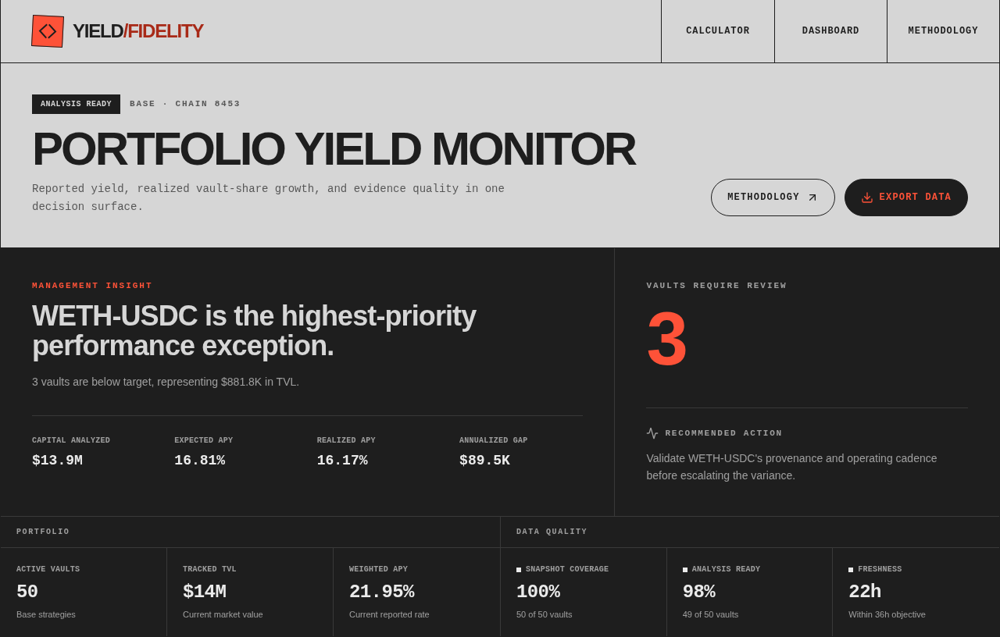

# Yield/Fidelity: checks whether active Beefy vaults on Base earn their reported APY

[](https://github.com/RahilBhavan/beefy-yield-fidelity-monitor/actions/workflows/ci.yml) [](LICENSE)

**Live:** https://yield.rahilbhavan.com



Yield/Fidelity is a Next.js dashboard for active Beefy vaults on the Base network. Once a day, it reads each vault's price per share (PPS) on-chain and stores the reading with its block provenance in Supabase. It then compares realized PPS growth with the APY that Beefy reported over the same intervals. It also has a calculator that estimates how many days a deposit needs to earn back its Base entry and exit costs.

## What it does

- **Tracks every active Base vault, up to 50.** `src/lib/beefy.ts` keeps Beefy vaults on Base with status `active`, sorts them by TVL and takes the largest 50 (`limit = 50`). The cap is a ceiling, not a target. On 24 Oct 2026, Beefy's public `/vaults` endpoint listed 537 Base vaults: 26 `active`, 200 `paused` and 311 `eol`. The live `/api/health` reported 26 tracked vaults and 100% snapshot coverage the same day, so the count matches Beefy's active list. On 21 Oct 2026 `/api/health` had reported 50; I did not record Beefy's list that day, so I cannot say which vaults left. Each daily run marks vaults missing from the active list inactive (`is_active = false`).
- **Compares realized and reported yield.** For each interval, the expected return uses the APY recorded at the start of that interval, not today's APY. The method is in `src/lib/drift.ts`.
- **Withholds results until the evidence is sufficient.** A vault gets a drift result only after at least 3 valid observations that span at least 7 days. A vault goes to review when its drift is −5% or lower.
- **Summarizes the portfolio.** The dashboard shows capital analyzed, TVL-weighted expected and realized APY, an annualized yield gap (`Σ TVL × (expected APY − realized APY)`), and a recommended action.
- **Estimates break-even days.** The calculator at `/` can use the live headline APY, the time-weighted recorded APY, or realized share-price growth. It shows downside, current, and upside scenarios.
- **Exposes its evidence.** `/api/export` returns the valid observations from the rolling 90-day window as CSV or JSON. `/api/health` reports RPC, freshness, and coverage status.

Observed on the live site on 21 Oct 2026: about $13.8M of capital analyzed, 3–5 vaults flagged for review, and an $89.5K annualized gap. Capital analyzed ranged from $13.7M to $13.9M across fetches that day. These values change with each daily snapshot and do not come from a file in this repository.

## How it works

1. Vercel Cron calls `/api/cron/scrape` daily at 01:15 UTC (`vercel.json`). The route requires the `CRON_SECRET` bearer token.
2. `src/lib/beefy.ts` loads vault, APY, TVL, and price data from the Beefy API.
3. `src/lib/pps.ts` reads `getPricePerFullShare()` and `decimals()` for every vault in one Multicall at a single Base block.
4. Ingestion functions in `supabase/migrations/` write snapshots, failures, and the run status in one transaction. Unique keys on `(chain, run_date)` and `(vault_id, snapshot_date)` make a retry safe.
5. `src/lib/drift.ts` and `src/lib/dashboard.ts` compute interval-matched drift, the evidence gate, and the portfolio summary for `src/app/dashboard/`.

The [project guide](docs/PROJECT_GUIDE.md) has the full architecture diagram, formulas, and database model.

## Run it

Prerequisites: Node.js 20 or later (CI uses Node.js 20) and npm. The dashboard needs a Supabase project. The calculator works without one. The database tests need PostgreSQL 16 and `psql`.

```bash
git clone https://github.com/RahilBhavan/beefy-yield-fidelity-monitor.git
cd beefy-yield-fidelity-monitor
npm ci
npm run check    # lint, unit and route tests, production build
```

`npm run check` ran 46 Vitest tests on 21 Oct 2026: 45 passed and 1 skipped. The skipped test is the opt-in live integration test. The other suites:

```bash
npm run test:e2e           # 16 Playwright cases (8 tests × desktop and mobile Chromium), with axe WCAG A/AA checks
npm run test:integration   # live Supabase and Base RPC test; needs credentials and network access
npm run test:load          # smoke load on one endpoint (default /api/data); needs a running server
```

To run the app:

```bash
cp .env.example .env.local
npm run dev
```

Open http://localhost:3000. Without Supabase settings, the dashboard shows an explicit "unconfigured" state. To collect data, set `NEXT_PUBLIC_SUPABASE_URL`, `NEXT_PUBLIC_SUPABASE_ANON_KEY`, `SUPABASE_SERVICE_ROLE_KEY`, and `CRON_SECRET` in `.env.local`. Apply the files in `supabase/migrations/` in filename order. Then start the first scrape:

```bash
curl -H "Authorization: Bearer $CRON_SECRET" http://localhost:3000/api/cron/scrape
```

`BASE_RPC_URLS` is optional. The public Base RPC is the fallback. Keep the service-role key out of browser code.

CI (`.github/workflows/ci.yml`) runs `npm run check`, `npm audit --omit=dev`, every migration plus `supabase/tests/production_fidelity_test.sql` on PostgreSQL 16, and the Playwright suite.

## Repository layout

- `src/app/`: pages (`/`, `/dashboard`, `/dashboard/strategies`, `/methodology`) and API routes (`cron/scrape`, `data`, `export`, `gas-estimate`, `health`).
- `src/components/`: calculator, portfolio table, and drift chart.
- `src/lib/`: Beefy adapter, PPS reads, gas model, drift method, and dashboard analysis, with their unit tests.
- `supabase/migrations/`: PostgreSQL schema, row-level security, and ingestion functions.
- `supabase/tests/`: database invariant tests.
- `tests/e2e/`: Playwright and axe browser tests.
- `scripts/`: the load-smoke script.
- `docs/`: project documentation.
- `.github/workflows/`: CI and a production health probe that runs every 15 minutes.
- `PRD.md`: the product requirements document.

## Documentation

- [Project guide](docs/PROJECT_GUIDE.md): architecture, formulas, database model, API routes, and verification.
- [Case study](docs/CASE_STUDY.md): the decision problem, the analytical approach, and the recommendation framework.
- [Operations runbook](docs/OPERATIONS.md): release steps, service objectives, alerts, incident response, and rollback.
- [Security model](docs/SECURITY.md): credential boundaries, row-level security, and rate limits.
- [Methodology](https://yield.rahilbhavan.com/methodology): the public methodology page on the live site.

## Sources

- **Beefy API.** vault list, APY, TVL, performance fee, and token prices. Each daily snapshot stores the APY and TVL from that run.
- **Base chain.** PPS and decimals read from each vault contract through Multicall. Each snapshot records the block number, block hash, and RPC provider label.
- **Date range.** Production collection started in August 2026 and adds one snapshot per vault per UTC day. The project does not backfill history.
- **Freezing.** The database keeps every snapshot. `/api/export` publishes the rolling 90-day window with its provenance, so you can recompute the dashboard figures.

Beefy data belongs to Beefy. The MIT license covers this project's code, not third-party data, names, or marks.

## Scope and limits

- Independent portfolio project. Not affiliated with or endorsed by Beefy.
- Decision support, not financial advice. A flagged vault is a variance to investigate, not a conclusion about its cause.
- Base only. The project does not model token-price exposure, impermanent loss, slippage, bridge costs, taxes, exploit risk, or future APY.
- The gas estimate uses representative 500,000-gas deposit and withdrawal transactions. It is not a wallet-specific quote.
- Short windows make annualized figures volatile. Interval APY inputs above 1,000% stay in the export but are left out of the analysis.
- Live figures change daily. This README gives each live figure with the date it was observed.

## License

MIT. See [LICENSE](LICENSE).

Part of [Rahil Bhavan's projects](https://github.com/RahilBhavan).
