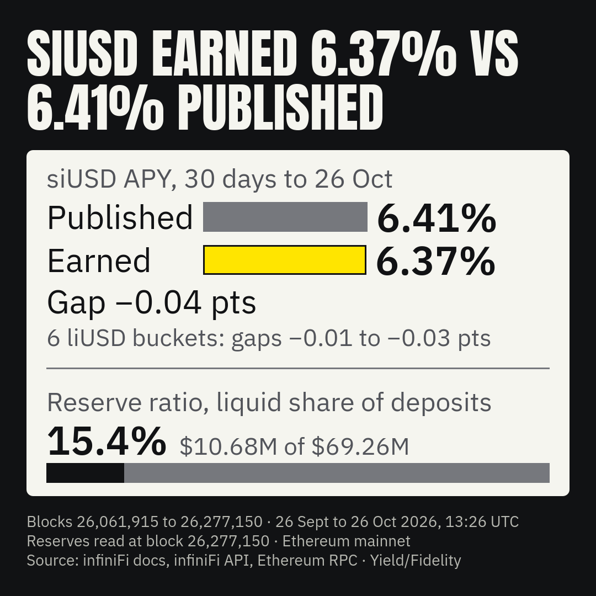

# Yield/Fidelity: checks whether active Beefy vaults on Base earn their reported APY

[](https://github.com/RahilBhavan/beefy-yield-fidelity-monitor/actions/workflows/ci.yml) [](LICENSE)

**Live:** https://yield.rahilbhavan.com


Yield/Fidelity is a Next.js dashboard for active Beefy vaults on the Base network. Once a day, it reads each vault's price per share (PPS) on-chain and stores the reading with its block provenance in Supabase. It then compares realized PPS growth with the APY that Beefy reported over the same intervals. It also has a calculator that estimates how many days a deposit needs to earn back its Base entry and exit costs.

## What it does

- **Tracks every active Base vault, up to 50.** `src/lib/beefy.ts` keeps Beefy vaults on Base with status `active`, sorts them by TVL and takes the largest 50 (`limit = 50`). The cap is a ceiling, not a target. On 24 Oct 2026, Beefy's public `/vaults` endpoint listed 537 Base vaults: 26 `active`, 200 `paused` and 311 `eol`. The live `/api/health` reported 26 tracked vaults and 100% snapshot coverage the same day, so the count matches Beefy's active list. On 21 Oct 2026 `/api/health` had reported 50; I did not record Beefy's list that day, so I cannot say which vaults left. Beefy's `/vaults` API shows 200 Base vaults paused at once at 2026-10-21 23:00 UTC (the shared `pausedAt` 1792623600), and the monitor's daily export shows tracked vaults falling from 50 to 26 between the 22 Oct and 23 Oct scrapes, with summed TVL in the export falling from about $13.9M to about $3.7M (about $13.6–14.2M across 13–22 Oct, about $3.3–3.7M across 23–25 Oct). Each daily run marks vaults missing from the active list inactive (`is_active = false`).
- **Compares realized and reported yield.** For each interval, the expected return uses the APY recorded at the start of that interval, not today's APY. The method is in `src/lib/drift.ts`.
- **Withholds results until the evidence is sufficient.** A vault gets a drift result only after at least 3 valid observations that span at least 7 days. A vault goes to review when its drift is −5% or lower.
- **Summarizes the portfolio.** The dashboard shows capital analyzed, TVL-weighted expected and realized APY, an annualized yield gap (`Σ TVL × (expected APY − realized APY)`), and a recommended action.
- **Estimates break-even days.** The calculator at `/` can use the live headline APY, the time-weighted recorded APY, or realized share-price growth. It shows downside, current, and upside scenarios.
- **Exposes its evidence.** `/api/export` returns the valid observations from the rolling 90-day window as CSV or JSON. `/api/health` reports RPC, freshness, and coverage status. `/api/summary` returns the dated headline figures that the snapshot archive stores.

Headline figures, as of 25 Oct 2026 (UTC date of the latest daily snapshot, [`snapshots/2026-10-25.json`](snapshots/2026-10-25.json)):

| Figure | Value |
| --- | --- |
| Capital analyzed | $3.17M (9 of 26 vaults pass the evidence gate) |
| Vaults requiring review | 3 |
| Annualized gap | $91.8K |
| Tracked vaults | 26 |

These values move with every daily snapshot. The dated [snapshot archive](snapshots/) keeps each day's figures in the repository, so a number quoted anywhere can be traced to a date. Earlier figures differ: the 21 Oct 2026 capture showed an $89.5K gap on 50 tracked vaults, before Beefy's active list shrank to 26. That capture was not archived. The 25 Oct file was recomputed from the public `/api/export` rows with the dashboard code, and it matches the live dashboard ($3.2M, 11.52% expected, 8.62% realized, $91.8K, 3 vaults). Later files come from `/api/summary` on the live site.

## How it works

1. Vercel Cron calls `/api/cron/scrape` daily at 01:15 UTC (`vercel.json`). The route requires the `CRON_SECRET` bearer token.
2. `src/lib/beefy.ts` loads vault, APY, TVL, and price data from the Beefy API.
3. `src/lib/pps.ts` reads `getPricePerFullShare()` and `decimals()` for every vault in one Multicall at a single Base block.
4. Ingestion functions in `supabase/migrations/` write snapshots, failures, and the run status in one transaction. Unique keys on `(chain, run_date)` and `(vault_id, snapshot_date)` make a retry safe.
5. `src/lib/drift.ts` and `src/lib/dashboard.ts` compute interval-matched drift, the evidence gate, and the portfolio summary for `src/app/dashboard/`.

The [project guide](docs/PROJECT_GUIDE.md) has the full architecture diagram, formulas, and database model.

## Run it

Prerequisites: Node.js 20 or later (CI uses Node.js 20) and npm. The dashboard needs a Supabase project. The calculator works without one. The database tests need PostgreSQL 16 and `psql`.

```bash
git clone https://github.com/RahilBhavan/beefy-yield-fidelity-monitor.git
cd beefy-yield-fidelity-monitor
npm ci
npm run check    # lint, unit and route tests, production build
```

`npm run check` ran 53 Vitest tests on 25 Oct 2026: 52 passed and 1 skipped. The skipped test is the opt-in live integration test. The other suites:

```bash
npm run snapshot           # write snapshots/<as-of date>.json from the live /api/summary
npm run test:e2e           # 16 Playwright cases (8 tests × desktop and mobile Chromium), with axe WCAG A/AA checks
npm run test:integration   # live Supabase and Base RPC test; needs credentials and network access
npm run test:load          # smoke load on one endpoint (default /api/data); needs a running server
```

To run the app:

```bash
cp .env.example .env.local
npm run dev
```

Open the URL that `npm run dev` prints (Next.js uses port 3000 unless it is taken). Without Supabase settings, the dashboard shows an explicit "unconfigured" state. To collect data, set `NEXT_PUBLIC_SUPABASE_URL`, `NEXT_PUBLIC_SUPABASE_ANON_KEY`, `SUPABASE_SERVICE_ROLE_KEY`, and `CRON_SECRET` in `.env.local`. Apply the files in `supabase/migrations/` in filename order. Then start the first scrape, with `APP_URL` set to the URL `npm run dev` printed:

```bash
curl -H "Authorization: Bearer $CRON_SECRET" "$APP_URL/api/cron/scrape"
```

`BASE_RPC_URLS` is optional. The public Base RPC is the fallback. Keep the service-role key out of browser code.

CI (`.github/workflows/ci.yml`) runs `npm run check`, `npm audit --omit=dev`, every migration plus `supabase/tests/production_fidelity_test.sql` on PostgreSQL 16, and the Playwright suite.

## infiniFi fidelity check

An outreach artifact that applies the same test to [infiniFi](https://docs.infinifi.xyz), an Ethereum stablecoin protocol: does the APY it publishes match what its share prices paid? It also reads the protocol's reserve ratio. Every figure is read from Ethereum or from infiniFi's own pages on the day of the run, and the report lists anything it could not read instead of estimating it.



Result for 26 Oct 2026, 13:26:23 UTC (Ethereum block 26,277,150, [`reports/infinifi/2026-10-26.json`](reports/infinifi/2026-10-26.json)):

| siUSD window | Published APY | Realized APY | Gap (points) |
| --- | --- | --- | --- |
| 30 days, block 26,061,915 (26 Sep 13:26 UTC) to 26,277,150 | 6.41% | 6.37% | −0.04 |
| 7 days, block 26,226,910 (19 Oct) to 26,277,150 | 6.58% | 6.56% | −0.02 |
| 1 day, block 26,269,982 (25 Oct) to 26,277,150 | 6.62% | 6.63% | +0.00 |

- **The longest window with a published figure is 30 days.** infiniFi's API publishes 1-, 7- and 30-day averages and no history, so the published side of any longer window is missing. For siUSD's whole life the report gives only the realized figure: 6.68% a year over 521.7 days from the first block with siUSD supply (block 22,540,590, 22 May 2025, a 1 iUSD seed), or 6.71% from the first block where the share price moved (block 22,556,133, 25 May 2025). The share price did not fall in any of 76 weekly samples.
- **The gap is small next to normal movement.** The annualized growth of one day ranged with a standard deviation of 0.54 points over the 30 days. The 30-day gap is 0.62% of the return the published APY implied; the dashboard's review line is −5%.
- **Locked tokens agree too.** Six of the 13 liUSD buckets hold more than 10,000 iUSD (the rest hold about 1.2 iUSD each and are not evaluated). Their 7-day gaps are 0.00 points and their 30-day gaps run from −0.01 to −0.03 points. Each 30-day realized figure is below the published one.
- **Reserve ratio: 15.42%.** The three liquid farms in the registry held 10,680,192.86 USDC against 69,260,083.53 iUSD outstanding at block 26,277,150. Counting the instant liquidity that maturity farms report, mostly from one farm, the ratio is 26.31%. infiniFi's API totals, fetched a minute later, differ from the on-chain liquid and illiquid sums by $1.05 and $1.79.

### Method

```bash
npm run infinifi                       # writes reports/infinifi/<UTC date>.json; takes about 5 minutes
node scripts/infinifi/card.mjs reports/infinifi/<date>.json card.html FONTS_DIR   # the 1080x1080 card source
```

- **Addresses** come from infiniFi's [contract page](https://docs.infinifi.xyz/dev-docs/contracts.md): iUSD, siUSD, Gateway, Farm Registry and the liUSD tokens. The run parses the page and records its hash. Farm names come from the docs [vaults page](https://docs.infinifi.xyz/vaults.md); a farm that page does not name stays unnamed.
- **Realized APY** is `expm1(ln(endRate / startRate) × 365 / days)`, the interval arithmetic in `src/lib/drift.ts` (a test checks the two agree). The siUSD rate is `convertToAssets(1e18)`. The liUSD rate is `LockingController.exchangeRate(weeks)`. Windows run from the block at or before the start time to a block 2 behind the head, so every read has settled.
- **Published APY** is the `average1dAPY`, `average7dAPY` and `average30dAPY` fields of `https://eth-api.infinifi.xyz/api/protocol/data`. The gap is realized minus published, in percentage points.
- **Reserve ratio** is the USDC held by farms the registry lists as liquid, divided by the iUSD supply, taken at par with USDC. It reads `FarmRegistry.getAssetTypeFarms` and each farm's `assets()` and `liquidity()`.
- **Two providers must agree.** Every chain read is repeated on independent public RPC providers until two return the same answer; a read with no agreement fails the run. The report names the providers that agreed.

### Limits

- **The API endpoint is not in infiniFi's docs.** The docs point to a backend repository that is not public. I could not open the app (it sits behind a browser check), so I cannot say which of these fields it shows.
- **Agreement is not independent proof.** The 7-day published figures for the locked tokens match the share price to within 0.0001 points, so the API appears to derive its averages from the same exchange rates. The check shows that infiniFi's arithmetic is consistent and that depositors received the share-price growth; it does not test the returns of the farms underneath.
- **The locking controller is not in the docs.** Its address (`0x1d95cC100D6Cd9C7BbDbD7Cb328d99b3D6037fF7`) is read from the documented Gateway, and the run accepts it only if its share tokens are the liUSD addresses the docs list.
- **One snapshot.** The reserve ratio is the state at one block. It does not model redemption queues, Aave utilization, the Curve exit route, or the credit risk of the maturity farms. `liquidity()` is each farm's own claim about instant withdrawals.
- **iUSD is taken at par.** The API reports an iUSD exchange rate of 1; I did not read a par price on-chain.
- **Design review is pending.** The card follows Rahil Design's palette and type (checked against bundle 3.11.0; the request named 3.3.2, which has the same fonts and palette). It fails the bundle's 326px phone-feed floors for small text, no reviewer has passed the exact bytes, and nothing has been posted. See [`reports/infinifi/2026-10-26-card.brief.json`](reports/infinifi/2026-10-26-card.brief.json).

## Repository layout

- `src/app/`: pages (`/`, `/dashboard`, `/dashboard/strategies`, `/methodology`) and API routes (`cron/scrape`, `data`, `export`, `gas-estimate`, `health`).
- `src/components/`: calculator, portfolio table, and drift chart.
- `src/lib/`: Beefy adapter, PPS reads, gas model, drift method, and dashboard analysis, with their unit tests.
- `supabase/migrations/`: PostgreSQL schema, row-level security, and ingestion functions.
- `supabase/tests/`: database invariant tests.
- `tests/e2e/`: Playwright and axe browser tests.
- `snapshots/`: one JSON file per as-of date with the headline figures, plus `index.json`.
- `scripts/`: the snapshot writer, the load-smoke script and `infinifi/` (the infiniFi collector, card builder and their tests).
- `reports/infinifi/`: the dated infiniFi report, its chart card and the card's design record.
- `docs/`: project documentation.
- `.github/workflows/`: CI and a production health probe that runs every 15 minutes.
- `PRD.md`: the product requirements document.

## Documentation

- [Project guide](docs/PROJECT_GUIDE.md): architecture, formulas, database model, API routes, and verification.
- [Case study](docs/CASE_STUDY.md): the decision problem, the analytical approach, and the recommendation framework.
- [Operations runbook](docs/OPERATIONS.md): release steps, service objectives, alerts, incident response, and rollback.
- [Security model](docs/SECURITY.md): credential boundaries, row-level security, and rate limits.
- [Methodology](https://yield.rahilbhavan.com/methodology): the public methodology page on the live site.

## Sources

- **Beefy API.** vault list, APY, TVL, performance fee, and token prices. Each daily snapshot stores the APY and TVL from that run.
- **Base chain.** PPS and decimals read from each vault contract through Multicall. Each snapshot records the block number, block hash, and RPC provider label.
- **Date range.** Production collection started in August 2026 and adds one snapshot per vault per UTC day. The project does not backfill history.
- **Freezing.** The database keeps every snapshot. `/api/export` publishes the rolling 90-day window with its provenance, so you can recompute the dashboard figures.

Beefy data belongs to Beefy. The MIT license covers this project's code, not third-party data, names, or marks.

## Scope and limits

- Independent portfolio project. Not affiliated with or endorsed by Beefy.
- Decision support, not financial advice. A flagged vault is a variance to investigate, not a conclusion about its cause.
- Base only. The project does not model token-price exposure, impermanent loss, slippage, bridge costs, taxes, exploit risk, or future APY.
- The gas estimate uses representative 500,000-gas deposit and withdrawal transactions. It is not a wallet-specific quote.
- Short windows make annualized figures volatile. Interval APY inputs above 1,000% stay in the export but are left out of the analysis.
- Live figures change daily. This README gives each headline figure with its as-of date and the archived file it comes from. Only 25 Oct 2026 is archived so far. The archive is written by running `npm run snapshot`; no scheduled job commits to it.

## License

MIT. See [LICENSE](LICENSE).

Part of [Rahil Bhavan's projects](https://github.com/RahilBhavan).
